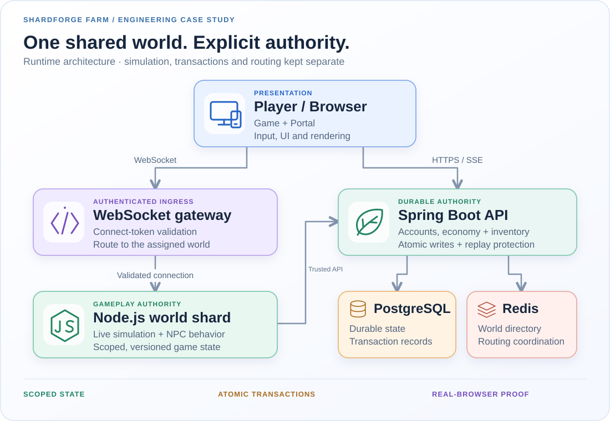
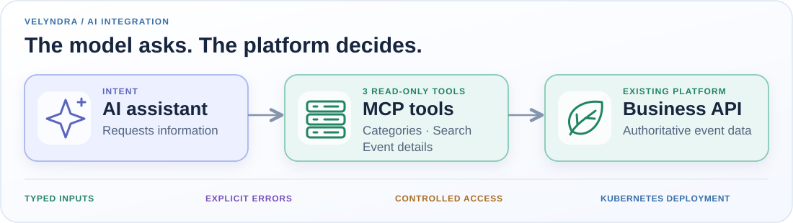

  <picture>
    <source media="(max-width: 600px)" srcset="assets/header-mobile-animated-v1.svg" />
    
  </picture>
  

    <strong><a href="mailto:attila.grynaeus@gmail.com">Let's talk →</a></strong> &nbsp;·&nbsp;
    <a href="https://www.linkedin.com/in/attila-grynaeus">LinkedIn</a> &nbsp;·&nbsp;
    <a href="#selected-work">Explore the systems</a> &nbsp;·&nbsp;
    <a href="#working-stack">Stack</a>
  

**Software Architect. Hands-on builder. 27+ years in enterprise software.**

I connect **Java/Spring engineering, distributed systems and LLM application architecture**. My work spans event technology, retail/ERP, banking and public services. I take systems from design through implementation, testing and deployment—not just the slide deck.

**What I bring:** production Java depth, AI integrations grounded in real business APIs, and the persistence to chase a failure across the browser, network and database.

## Selected systems · the work behind the stack

### 01 / SHARDFORGE FARM — multiplayer systems engineering

**Cozy pixels. Serious backend.** *Public codename · private source · active development*

**Challenge.** Two players harvest the same crop. A connection drops. One command gets retried. The crop, inventory and both players' screens still need to agree.

**Built.** A TypeScript/Node.js world runtime with a separate Java/Spring persistence boundary: authenticated WebSocket routing, explicit world/map/instance identity, binary messages, versioned snapshots and transactional crop/inventory writes. Typed EventBus contracts connect gameplay modules; OpenAPI-generated clients connect services.

<picture>
  <source media="(max-width: 600px)" srcset="assets/system-mobile.svg" />
  
</picture>

**Result.** A competing harvest is resolved at the transaction boundary. Replaying the same accepted command cannot grant another reward. Clients reject stale or wrong-map state rather than letting an old packet rewrite the world.

| Hard problem | Engineering decision | Player-visible effect |
| --- | --- | --- |
| Concurrent actions and retries | Atomic state + inventory commit; replay identity | No second reward from the same harvest |
| Travel and reconnects | Explicit scope transitions; snapshot/version gates | Old-map updates cannot overwrite the new map |
| A test that passes for only one player | Real-browser PlayBot actor + passive observer | Check the action **and** what another player sees |

**The trade-off:** live simulation stays in Node; durable economic changes cross the Spring transaction boundary. Movement does not need a database round trip every frame. PlayBot exercises real input and protocol paths—not inventory edits disguised as tests.

### 02 / Velyndra Event Systems — AI that calls the real business

*Delivered client integration · Velyndra is a fictional client alias.*

**Challenge.** Give an AI assistant useful access to an event platform without inventing business records or expanding its permissions.

**Built.** I designed and delivered **three read-only MCP tools** for categories, search and event details: typed inputs, validation, controlled API access, localized results and explicit failure paths. The integration was deployed in a Kubernetes-based cloud environment.

<picture>
  <source media="(max-width: 600px)" srcset="assets/velyndra-architecture-mobile.svg" />
  
</picture>

**Result.** An end-to-end connection between the assistant and existing platform data, verified through tool calls and failure-path testing. The model can request information; it cannot grant itself new business permissions.

**The trade-off:** a narrow, read-only tool surface instead of a general-purpose API wrapper. Less room for ambiguous tool calls; a clearer boundary to test and operate.

### 03 / Bison Schweiz AG — cloud pricing & ERP modernization

**Challenge.** Evolve enterprise pricing and integrations while keeping the delivery and operating model maintainable.

**Built.** Spring Boot pricing services on **Azure and Kubernetes**, REST and messaging integrations, plus work on GitOps, automated testing and production observability.

**Result.** Delivered pricing-service and integration work as part of the broader modernization effort, with delivery automation and operational visibility treated as engineering concerns—not cleanup tasks.

## Code you can actually inspect

**[PrompTee](https://github.com/attilagrynaeus/Promptee)** — Collaborative prompt workspace using React, Supabase and serverless functions. **[UI regression test →](https://github.com/attilagrynaeus/Promptee/blob/main/src/__tests__/PromptCard.deleteConfirm.test.jsx)**

**[AI Test Generator](https://github.com/attilagrynaeus/ai-test-generator)** — Java/Spring proof of concept for generating JUnit scaffolding from API descriptions. **[Input validation code →](https://github.com/attilagrynaeus/ai-test-generator/blob/main/server/src/main/java/com/ag/server/validation/ApiSpecValidator.java)**

## Working stack

**Backend & data:** Java 17–25 · Spring Boot · PostgreSQL · REST/OpenAPI · Kafka · Redis · Node.js · TypeScript  
**AI engineering:** LLM applications · MCP · tool/function calling · AI agents · RAG · secure API integration  
**Cloud & delivery:** Kubernetes · Docker · Azure · Google Cloud · GitOps · OpenTelemetry · automated testing

**Sun certifications:** Java Programmer (SCJP) · Business Component Developer (SCBCD).

## Need someone who can own the hard part?

Interested in **Staff / Principal Engineer, Software Architect and AI Platform** roles where architecture and hands-on delivery belong together.

**[attila.grynaeus@gmail.com](mailto:attila.grynaeus@gmail.com)** · **[LinkedIn](https://www.linkedin.com/in/attila-grynaeus)** · [Writing](https://mindjourneylabs.com)

  
More experiments &amp; GitHub activity

  
<a href="https://github.com/attilagrynaeus/troubleshoot-ai-assist">WildFly AI Assist</a> explores documentation-backed application troubleshooting. <a href="https://github.com/attilagrynaeus?tab=repositories">Browse public repositories</a> or <a href="https://github.com/attilagrynaeus">view contribution activity</a>.

