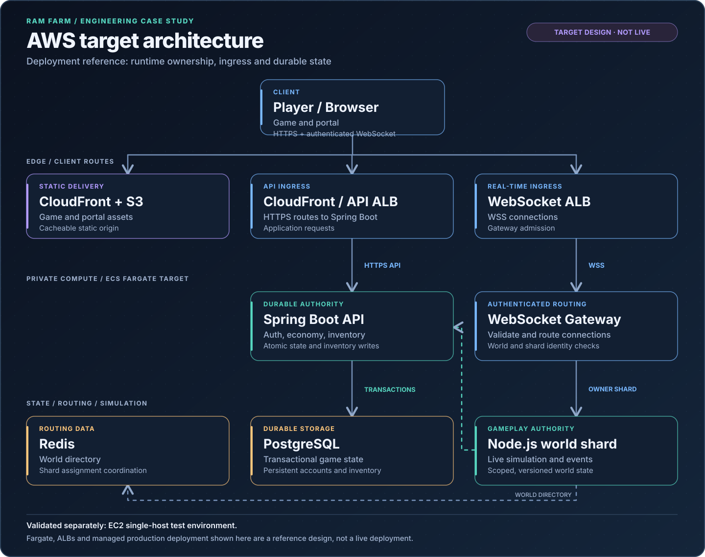
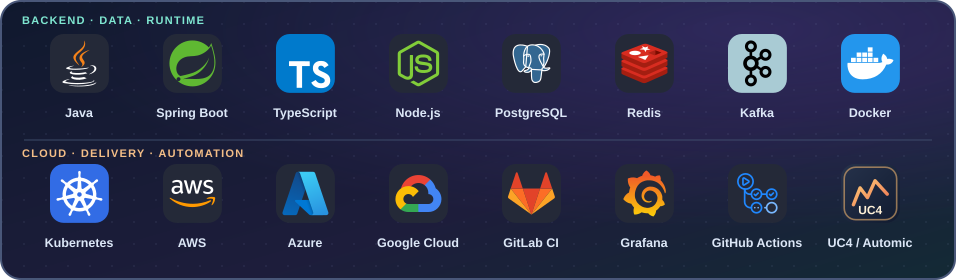
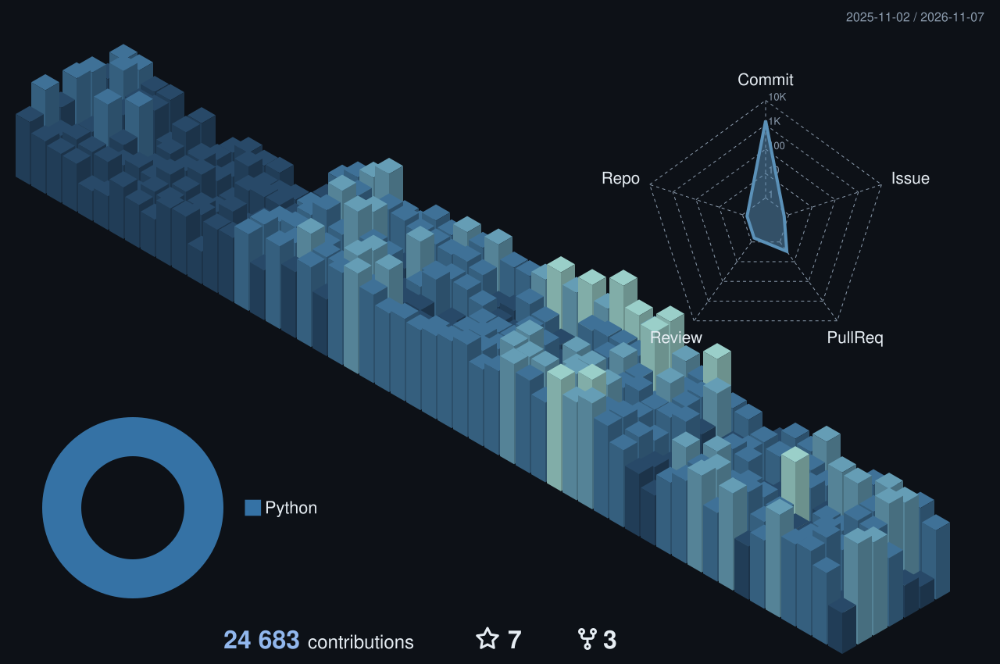

  <picture>
    <source media="(max-width: 600px)" srcset="assets/header-mobile-animated-v1.svg" />
    
  </picture>
  
<strong>AVAILABLE FOR FULLY REMOTE CONTRACTS AND SENIOR ENGINEERING ROLES</strong>

  

    <strong><a href="mailto:attila.grynaeus@gmail.com?subject=Remote%20engineering%20project">Discuss a project</a></strong> &nbsp;·&nbsp;
    <a href="https://www.linkedin.com/in/attila-grynaeus">LinkedIn</a> &nbsp;·&nbsp;
    <a href="#selected-work">Engineering evidence</a> &nbsp;·&nbsp;
    <a href="#public-code">Public code</a>
  

# Independent Software Architect | Senior Java / Distributed Systems Engineer

**I take ownership of complex software, from architecture through implementation, testing and deployment.** I bring **27+ years of enterprise engineering** across Java/Spring, distributed backends, cloud platforms and real-world AI integrations. I can lead a critical workstream independently, join a delivery team as a senior individual contributor, or own a backend/platform build end to end.

**Based in Albania (European time zone).** Open to **100% remote international contracts**, independent consulting, and **Staff/Principal Engineer or Software Architect** engagements. Interested in substantive engineering work, not architecture advice without delivery.

## What you can hire me to deliver

| Your problem | What I can own | Evidence |
| --- | --- | --- |
| Complex Java backend or service architecture | Design, implementation, transactions, APIs, integration tests and release readiness | [Multiplayer platform](#shardforge-farm), [public Java code](#public-code) |
| Real-time or distributed systems | WebSocket protocols, authoritative state, replay protection, reconnect consistency and fault handling | [Multiplayer case study](#shardforge-farm) |
| AI agents that connect to business systems | MCP tools, scoped permissions, API validation, deployment and tests | [Eventfrog integration](#ai-systems) |
| Cloud / platform modernization | Kubernetes, GitOps, observability, AWS staging and deployment engineering | [Enterprise work](#enterprise-delivery), [AWS target diagram](assets/aws-target-architecture.svg) |

**Have a difficult system to build or stabilize?** [Email me with the problem, scope and timeline](mailto:attila.grynaeus@gmail.com?subject=Independent%20architecture%20contract).

## Selected work: systems I designed and built

### Independent Software Architect — Real-Time Multiplayer Platform

<picture>
  <source media="(max-width: 600px)" srcset="assets/project-shardforge-mobile.svg" />
  
</picture>

**SHARDFORGE FARM / RAM FARM** · Independent product engineering · Private source · Active development

**Ownership.** I designed and implemented the real-time multiplayer backend and its Java/Spring transaction boundary, with test coverage and cloud test deployment. This is a working engineering case study, **not a claim of a launched production-scale game**. Architecture and selected technical evidence are available for review.

**Challenge.** Two players harvest the same crop. A connection drops. One command gets retried. The crop, inventory and both players' screens still need to agree.

**Built.** A TypeScript/Node.js world runtime with a separate Java/Spring persistence boundary: authenticated WebSocket routing, explicit world/map/instance identity, binary messages, versioned snapshots and transactional crop/inventory writes. Typed EventBus contracts connect gameplay modules; OpenAPI-generated clients connect services.

<picture>
  <source media="(max-width: 600px)" srcset="assets/system-mobile-dark-v2.svg" />
  
</picture>

  
<strong>AWS architecture reference — target deployment diagram</strong>

  

  
The separate AWS EC2 single-host test environment has verified service health, HTTPS and authenticated WSS. The production-style Fargate topology shown above remains a target design; no production-scale load claim is implied.

**Result.** A competing harvest is resolved at the transaction boundary. Replaying the same accepted command cannot grant another reward. Clients reject stale or wrong-map state rather than letting an old packet rewrite the world.

| Hard problem | Engineering decision | Player-visible effect |
| --- | --- | --- |
| Concurrent actions and retries | Atomic state + inventory commit; replay identity | No second reward from the same harvest |
| Travel and reconnects | Explicit scope transitions; snapshot/version gates | Old-map updates cannot overwrite the new map |
| A test that passes for only one player | Real-browser PlayBot actor + passive observer | Check the action **and** what another player sees |

**The trade-off:** live simulation stays in Node; durable economic changes cross the Spring transaction boundary. Movement does not need a database round trip every frame. PlayBot exercises real input and protocol paths—not inventory edits disguised as tests.

### Eventfrog — ChatGPT AI / MCP integration

<picture>
  <source media="(max-width: 600px)" srcset="assets/project-velyndra-mobile.svg" />
  
</picture>

*Publicly released integration · [Eventfrog product announcement](https://eventfrog.ch/en/about-us/product-updates.html) (August 2026).*

**Challenge.** Give an AI assistant useful access to an event platform without inventing business records or expanding its permissions.

**Built.** I designed and delivered **three read-only MCP tools** for categories, search and event details: typed inputs, validation, controlled API access, localized results and explicit failure paths. The integration was deployed in a Kubernetes-based cloud environment.

<picture>
  <source media="(max-width: 600px)" srcset="assets/velyndra-architecture-mobile-dark-v2.svg" />
  
</picture>

**Result.** An end-to-end connection between the assistant and existing platform data, verified through tool calls and failure-path testing. The model can request information; it cannot grant itself new business permissions.

**The trade-off:** a narrow, read-only tool surface instead of a general-purpose API wrapper. Less room for ambiguous tool calls; a clearer boundary to test and operate.

### Bison Schweiz AG — cloud pricing and ERP modernization

<picture>
  <source media="(max-width: 600px)" srcset="assets/project-enterprise-mobile.svg" />
  
</picture>

**Challenge.** Evolve enterprise pricing and integrations while keeping the delivery and operating model maintainable.

**Built.** Spring Boot pricing services on **Azure and Kubernetes**, REST and messaging integrations, plus work on GitOps, automated testing and production observability.

**Result.** Delivered pricing-service and integration work as part of the broader modernization effort, with delivery automation and operational visibility treated as engineering concerns—not cleanup tasks.

## Public code and engineering evidence

**[PrompTee](https://github.com/attilagrynaeus/Promptee)** — Collaborative prompt workspace using React, Supabase and serverless functions. **[UI regression test →](https://github.com/attilagrynaeus/Promptee/blob/main/src/__tests__/PromptCard.deleteConfirm.test.jsx)**

**[AI Test Generator](https://github.com/attilagrynaeus/ai-test-generator)** — Java/Spring proof of concept for generating JUnit scaffolding from API descriptions. **[Input validation code →](https://github.com/attilagrynaeus/ai-test-generator/blob/main/server/src/main/java/com/ag/server/validation/ApiSpecValidator.java)**

## Working stack

<picture>
  <source media="(max-width: 600px)" srcset="assets/stack-icons-mobile-v1.svg" />
  
</picture>

**Core:** Java/Spring · Node.js/TypeScript · PostgreSQL/Redis · Kafka · OpenAPI  
**AI:** MCP · agentic AI · secure tools and APIs  
**Cloud & operations:** Kubernetes/Docker · Azure/GCP · AWS (target architecture) · GitOps · Grafana · **UC4 / Automic** (workload automation)

**Sun certifications:** Java Programmer (SCJP) · Business Component Developer (SCBCD).

<strong>GitHub contribution activity (optional)</strong>

  
  

Generated from GitHub data. Contribution charts are not performance benchmarks.

## Available for serious independent engineering work

I am available for **fully remote international engagements from Albania**, including independent architecture and development contracts, senior technical ownership, Staff/Principal engineering and AI platform integration work.

**I don't stop at diagrams.** I can take a defined outcome from requirements and architecture to working code, tests, deployment and operational handover. I am equally comfortable working independently or alongside your existing engineering team.

**Contact:** **[attila.grynaeus@gmail.com](mailto:attila.grynaeus@gmail.com?subject=Remote%20software%20architecture%20contract)** · **[LinkedIn](https://www.linkedin.com/in/attila-grynaeus)** · [Website / writing](https://mindjourneylabs.com)

  
More experiments &amp; GitHub activity

  
<a href="https://github.com/attilagrynaeus/troubleshoot-ai-assist">WildFly AI Assist</a> explores documentation-backed application troubleshooting. <a href="https://github.com/attilagrynaeus?tab=repositories">Browse public repositories</a> or <a href="https://github.com/attilagrynaeus">view contribution activity</a>.

