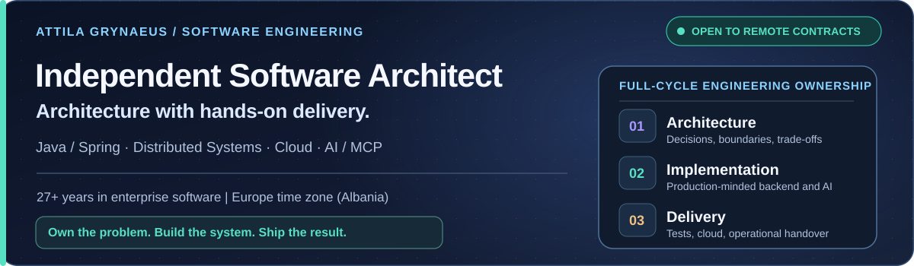
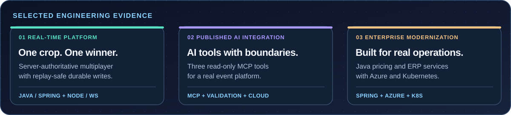

  <picture>
    <source media="(max-width: 700px)" srcset="assets/remote-architect-hero-mobile.svg" />
    
  </picture>
  

    <a href="mailto:attila.grynaeus@gmail.com?subject=Remote%20software%20architecture%20contract"><strong>Discuss a remote contract</strong></a>
    &nbsp;&nbsp;|&nbsp;&nbsp;
    <a href="https://www.linkedin.com/in/attila-grynaeus">LinkedIn</a>
    &nbsp;&nbsp;|&nbsp;&nbsp;
    <a href="#selected-work">Engineering evidence</a>
    &nbsp;&nbsp;|&nbsp;&nbsp;
    <a href="#public-code">Public code</a>
  

# Independent Software Architect — Available for Remote Contracts

**I take ownership of difficult software projects, from architecture through working code, integration tests, deployment and handover.** With **27+ years in enterprise software**, I combine Java/Spring depth, distributed systems engineering, cloud delivery and practical AI integrations.

**Based in Albania, European time zone.** Available for **100% remote international contracts**, independent consulting and Staff/Principal-level engineering engagements. I work hands-on, independently or with an existing team.

## Selected engineering evidence

<picture>
  <source media="(max-width: 700px)" srcset="assets/engineering-evidence-mobile.svg" />
  
</picture>

**Explore the work:** [Real-time multiplayer platform](#multiplayer) &nbsp;|&nbsp; [Eventfrog AI / MCP integration](#eventfrog) &nbsp;|&nbsp; [Enterprise cloud engineering](#enterprise)

## What you can hire me to own

| Engineering need | Ownership I can provide |
| --- | --- |
| **Java / Spring platform** | Service design, APIs, persistence, transactions, integrations, testing and delivery |
| **Distributed and real-time backends** | WebSocket protocols, authoritative state, concurrency, reconnects and fault handling |
| **AI agents / MCP for real business systems** | Purpose-built tools, typed inputs, permissions, secure API boundaries and deployment |
| **Cloud / DevOps engineering** | Kubernetes, CI/CD, GitOps, observability and operational readiness |

**My focus is accountability for the delivered system, not architecture diagrams alone.**

---

## 01 / Independent Software Architect — Real-Time Multiplayer Platform

**RAM FARM / SHARDFORGE FARM** &nbsp;|&nbsp; Independent product engineering &nbsp;|&nbsp; Private source, active development

I designed and built a **server-authoritative multiplayer backend** using **Java/Spring Boot, TypeScript/Node.js, WebSockets, PostgreSQL and Redis**. Live world simulation and durable economic transactions have distinct ownership boundaries.

**The engineering problem:** two players can try to harvest the same crop while a connection drops or a request is retried. The system has to award the reward **once** and bring both clients back to the same state.

<picture>
  <source media="(max-width: 700px)" srcset="assets/system-mobile-dark-v2.svg" />
  
</picture>

| Problem | Design choice | Why it matters |
| --- | --- | --- |
| Simultaneous commands or retries | Atomic crop/inventory transaction and replay identity | Prevents a second reward |
| Reconnects or world transitions | Scoped and versioned snapshots | Rejects stale or wrong-map updates |
| Tests that miss what another player sees | Real-browser actor and passive observer | Exercises both ends of the game session |
| Simulation coupled to persistence | Node.js live world with a Spring transaction boundary | Avoids database writes every simulation frame |

**Deployment evidence:** I also implemented a **single-host AWS EC2 test stack** for the API, game runtime, gateway, PostgreSQL and Redis. The public case-study diagram below is the **planned Fargate architecture**, not a claim that a large production system is deployed.

  
<strong>Open AWS target-deployment architecture</strong>

  

  
EC2 single-host test evidence and Fargate production-style target are intentionally distinguished. No concurrent-player capacity benchmark is claimed.

*Commercial source remains private; selected architecture, trade-offs and engineering evidence are presented here.*

---

## 02 / Eventfrog — ChatGPT AI / MCP Integration

**Publicly released integration** &nbsp;|&nbsp; [Eventfrog product announcement](https://eventfrog.ch/en/about-us/product-updates.html) (August 2026)

I designed and delivered **three read-only MCP tools** for an existing event platform: categories, event search and event details. The integration uses typed inputs, validation, scoped access to authoritative business APIs, localized responses and explicit failure handling. It runs in a Kubernetes-based cloud environment.

<picture>
  <source media="(max-width: 700px)" srcset="assets/velyndra-architecture-mobile-dark-v2.svg" />
  
</picture>

**Architectural decision:** the assistant can request platform data; it does **not** acquire permission to change business records. A small, testable tool surface is safer and easier to operate than exposing a general-purpose API.

---

## 03 / Bison Schweiz AG — Java Cloud and ERP Modernization

**Enterprise engineering delivery** &nbsp;|&nbsp; Java / Spring Boot / Azure / Kubernetes

Contributed to Spring Boot pricing services, enterprise REST and messaging integrations, automated testing, GitOps and observability in a broader cloud and ERP modernization effort.

**Focus:** maintainable integrations, predictable release workflows and production operational visibility. This was team-based enterprise delivery, distinct from my independent multiplayer product work.

---

## Public code you can inspect

| Repository | What it demonstrates |
| --- | --- |
| **[AI Test Generator](https://github.com/attilagrynaeus/ai-test-generator)** | Java/Spring proof of concept for generating JUnit scaffolding from API descriptions; [inspect input validation code](https://github.com/attilagrynaeus/ai-test-generator/blob/main/server/src/main/java/com/ag/server/validation/ApiSpecValidator.java) |
| **[PrompTee](https://github.com/attilagrynaeus/Promptee)** | React, Supabase and serverless collaboration workspace; [inspect a UI regression test](https://github.com/attilagrynaeus/Promptee/blob/main/src/__tests__/PromptCard.deleteConfirm.test.jsx) |
| **[WildFly AI Assist](https://github.com/attilagrynaeus/troubleshoot-ai-assist)** | Documentation-backed application troubleshooting experiment |

## Working stack

<picture>
  <source media="(max-width: 700px)" srcset="assets/stack-icons-mobile-v1.svg" />
  
</picture>

**Backend:** Java / Spring Boot, TypeScript / Node.js, PostgreSQL, Redis, Kafka, OpenAPI

**AI engineering:** MCP, AI agents, API integration, scoped tool access and validation

**Cloud / operations:** Docker, Kubernetes, Azure, GCP, AWS staging and target design, GitOps, GitLab CI, Grafana, UC4 / Automic

**Certifications:** Sun Certified Java Programmer (SCJP) and Sun Certified Business Component Developer (SCBCD).

---

## Real-Time Concurrency Demo

**Two players. One shared crop. One durable reward.** This animated real-time system illustration shows how competing WebSocket actions reach a Node.js world shard, while Spring Boot and PostgreSQL enforce a single transactional outcome. Redis supports world-routing coordination.

<picture>
  <source media="(max-width: 700px)" srcset="assets/realtime-simulation-mobile.svg" />
  
</picture>

Looped technical illustration of the system design, not a live production dashboard or a concurrency benchmark.

**The engineering principle:** keep simulation responsive, make durable rewards replay-safe, and converge both clients on the same authoritative state.

---

## Available for serious independent engineering work

**Need someone who can own the hard part and deliver it?** I am open to remote software architecture, Java backend, distributed platform, AI integration and cloud engineering engagements, including short-to-long-term contracts.

**Based in Albania. Working internationally in European business hours.**

**[Discuss a project by email](mailto:attila.grynaeus@gmail.com?subject=Independent%20remote%20engineering%20contract)** &nbsp;|&nbsp; [LinkedIn](https://www.linkedin.com/in/attila-grynaeus) &nbsp;|&nbsp; [Website / writing](https://mindjourneylabs.com)

## GitHub contribution history

  
  

Activity charts are not engineering performance or production availability benchmarks.
