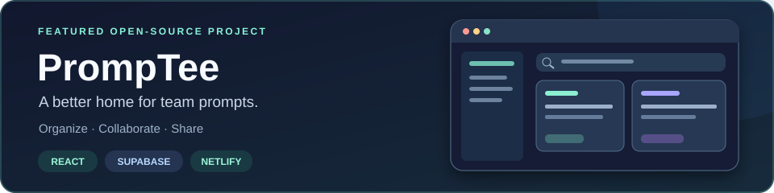
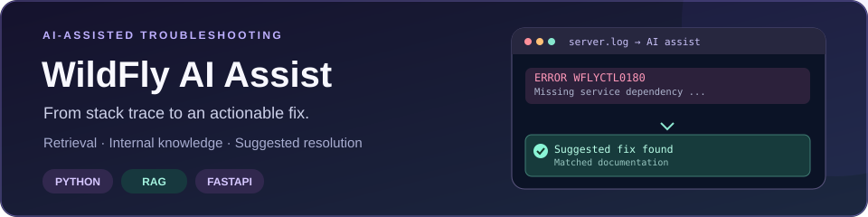
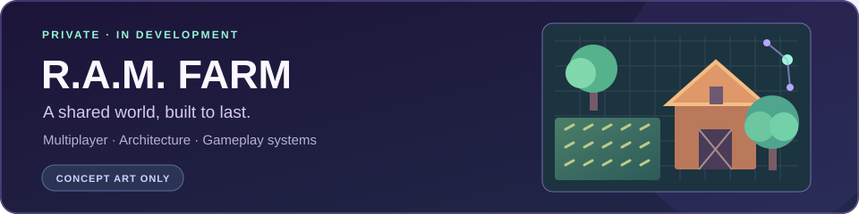

  

  

    
    
    
  

## Hello, I'm Attila 👋

I'm a **senior software engineer and architect** with **25+ years of enterprise development experience**, focused on Java, Spring, reliable backends, and developer productivity.

Today I also explore **AI-powered developer tools**, **agent-assisted engineering**, and **multiplayer game systems**. My approach stays the same across all of them: clear contracts, simple architecture, good tests, and systems that can be operated with confidence.

Previously certified as a **Sun Certified Java Programmer (SCJP)** and **Sun Certified Business Component Developer (SCBCD)**.

## Selected work

### [PrompTee](https://github.com/attilagrynaeus/Promptee) · Collaborative prompt management

A workspace for creating, organizing, sharing, and finding AI prompts. Its public repository documents real-time collaboration, authentication, export, and a serverless delivery pipeline.

**Built with:** React · TypeScript · Supabase / PostgreSQL · Netlify

### [WildFly AI Assist](https://github.com/attilagrynaeus/troubleshoot-ai-assist) · Troubleshooting with AI

A retrieval-augmented assistant (**RAG**) that connects WildFly stack traces to internal documentation and suggests actionable fixes instead of leaving engineers to search through logs by hand.

**Built with:** Python · FastAPI · FAISS · Confluence

### R.A.M. FARM · Multiplayer game world

A **private, in-development** multiplayer farming game project. My focus is on the engineering behind a shared world: dependable server-owned gameplay, clear client/server boundaries, and automated gameplay verification.

**Focus:** Game architecture · TypeScript · Java / Spring · Multiplayer systems

Concept illustration only. The game repository, source code, and production assets remain private.

### [AI Test Generator](https://github.com/attilagrynaeus/ai-test-generator) · Java proof of concept

An experimental Java/Spring tool for generating JUnit 5 test scaffolding from REST and GraphQL API descriptions. **Demo repository, not an actively maintained service.**

## Engineering focus

| Area | What I build |
| --- | --- |
| **Backend architecture** | Java, Spring Boot, APIs, domain modeling, PostgreSQL |
| **Delivery and operations** | Docker, Kubernetes, CI/CD, GitHub Actions, observability |
| **AI-assisted engineering** | LLM integrations, retrieval, coding agents, developer tools |
| **Interactive systems** | TypeScript, event-driven systems, multiplayer synchronization |

## How I work

- **Solve the real problem.** Prefer a small reliable solution over an impressive but unnecessary platform.
- **Make behavior explicit.** Strong contracts, clear ownership, and predictable failures.
- **Prove it works.** Automated tests and real user journeys matter more than dashboards full of badges.
- **Keep improving.** I enjoy mentoring, learning, and connecting product goals with engineering decisions.

## Connect

I write about software architecture, AI-powered development, and engineering practice at **[MindJourney Labs](https://mindjourneylabs.com)**.

Find me on **[LinkedIn](https://www.linkedin.com/in/attila-grynaeus)** or reach out at **[attila@grynaeus.dev](mailto:attila@grynaeus.dev)**.

  

