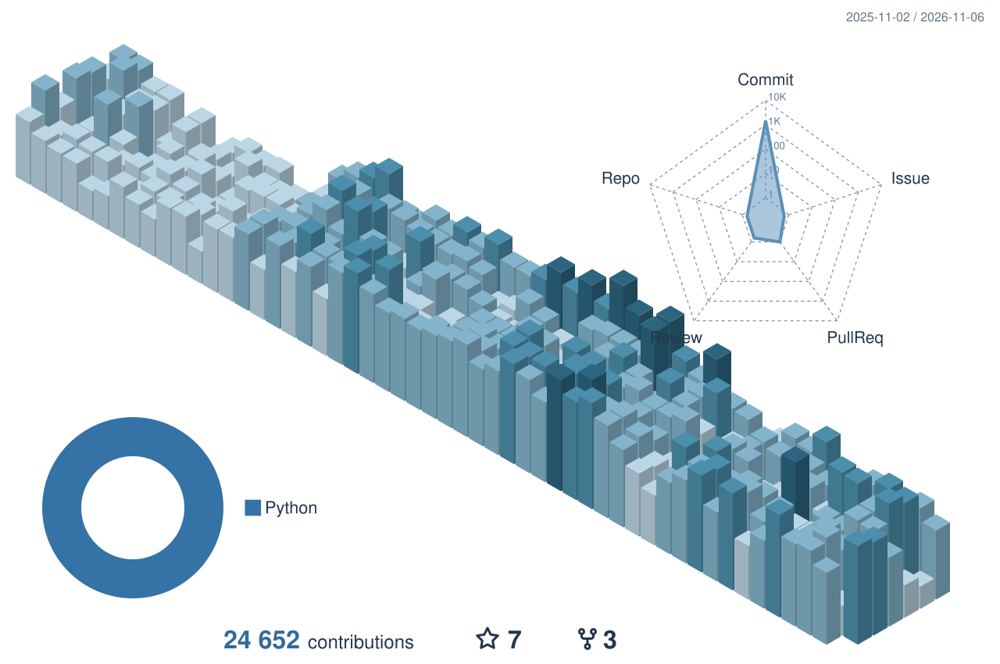

  <picture>
    <source media="(max-width: 600px)" srcset="assets/header-mobile.svg" />
    
  </picture>
  
  

    <a href="https://www.linkedin.com/in/attila-grynaeus">LinkedIn ↗</a> &nbsp; · &nbsp;
    <a href="https://mindjourneylabs.com">MindJourney Labs ↗</a> &nbsp; · &nbsp;
    <a href="mailto:attila@grynaeus.dev">Email ↗</a>
  

I'm Attila, a **senior Java/Spring engineer** with **25+ years in enterprise software**. I work across backend design, delivery and the awkward bugs between services. I also lead and mentor engineers.

Alongside my enterprise work, I'm building a multiplayer farming game and experimenting with tools that make development less repetitive.

**Sun-certified:** Java Programmer (SCJP) · Business Component Developer (SCBCD)

## R.A.M. FARM

A multiplayer farming world I'm building. The interesting engineering problem isn't drawing a crop: it's making sure two players cannot harvest it twice, and that reconnecting doesn't bring old state back.

<a href="docs/ram-farm.md">
  <picture>
    <source media="(max-width: 900px)" srcset="assets/system-mobile.svg" />
    
  </picture>
</a>
 

The client handles input and presentation. The server validates shared actions; persistent inventory and ownership changes are transactional. Browser-driven gameplay tests exercise the same paths a player uses.

**[Read the engineering notes →](docs/ram-farm.md)**

Private project · In development

## Public code

  
  

**[PrompTee](https://github.com/attilagrynaeus/Promptee)** — A shared workspace for saving, finding and reusing prompts. React, Supabase and a serverless backend. [A small UI regression test](https://github.com/attilagrynaeus/Promptee/blob/main/src/__tests__/PromptCard.deleteConfirm.test.jsx).

**[AI Test Generator](https://github.com/attilagrynaeus/ai-test-generator)** — A Java/Spring experiment that turns API descriptions into JUnit test scaffolding. [Start with the input validator](https://github.com/attilagrynaeus/ai-test-generator/blob/main/server/src/main/java/com/ag/server/validation/ApiSpecValidator.java). A demo, not a maintained service.

Also: **[WildFly AI Assist](https://github.com/attilagrynaeus/troubleshoot-ai-assist)** connects application errors with relevant internal documentation using retrieval-augmented generation.

## Working stack

  

Java and Spring are my core. Around them: PostgreSQL, containers, CI/CD and TypeScript. Python is useful for the AI tooling.

## GitHub activity

<picture>
  <source media="(prefers-color-scheme: dark)" srcset="profile/activity-dark.svg" />
  
</picture>

  
Activity details

   
  

Updated daily. Only activity exposed by GitHub is shown; private project details stay private.

---

I write at **[MindJourney Labs](https://mindjourneylabs.com)**. For a conversation about Java/Spring engineering, architecture or developer tooling: **[LinkedIn](https://www.linkedin.com/in/attila-grynaeus)** or **[attila@grynaeus.dev](mailto:attila@grynaeus.dev)**.
