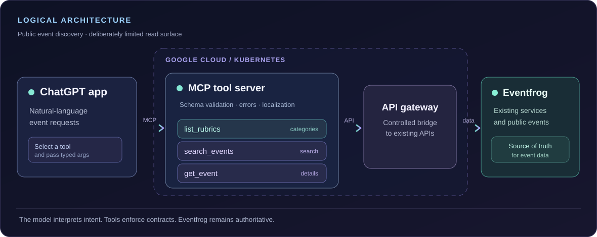

  <picture>
    <source media="(max-width: 680px)" srcset="../assets/eventfrog-case-hero-mobile.svg" />
    
  </picture>

# Eventfrog × ChatGPT — an MCP integration that shipped

**Eventfrog AG · 2026 · AI integration, backend architecture and cloud delivery**

I was the **sole AI integration and MCP engineer** for Eventfrog's public ChatGPT integration, taking it from design through implementation, testing and release. Eventfrog announced availability in **August 2026**. This is a case study about connecting an AI assistant to a real business system, not about training a model or building a chatbot demo.

[**Try the public ChatGPT app**](https://chatgpt.com/plugins/plugin_asdk_app_6a3a779388f48191b85e9d2f28b8c95d) · [**Eventfrog's launch announcement**](https://eventfrog.ch/en/about-us/product-updates.html) · [**Organizer FAQ**](https://eventfrog.de/en/help/organizer/boostprofits/promotion/ai-search.html)

## The engineering problem

Eventfrog already had the event data. The challenge was making that data **useful and trustworthy inside a conversation**. A user may ask, "What concerts are happening in Zurich this weekend?" The model can interpret the intent, but the event listing, dates and details must come from Eventfrog — not from a plausible-sounding generated answer.

That called for a deliberately small, typed interface between an AI agent and the existing platform: predictable tools, validated arguments, consistent results and errors that remain understandable when an upstream system fails.

## The architecture

  <picture>
    <source media="(max-width: 680px)" srcset="../assets/eventfrog-architecture-mobile.svg" />
    
  </picture>

*Logical architecture, not an infrastructure inventory. Private service names, endpoints, internal routing and secrets are intentionally omitted.*

The architecture separates four responsibilities:

1. **ChatGPT handles conversation and tool selection.** A natural-language request becomes a structured tool call. The model does not own Eventfrog's event records.
2. **The MCP server owns the tool contract.** I built the three tools, their schemas, input validation, localized result handling and explicit error paths.
3. **The API gateway connects the integration to existing services.** The integration runs in a microservice/API-gateway setup deployed on **Google Cloud Kubernetes**.
4. **Eventfrog remains the source of truth.** Search results and event details come from its event data, not from an independent model-maintained catalog.

## Three tools, not a general-purpose back door

| Publicly listed tool | Purpose | Boundary |
| --- | --- | --- |
| `list_rubrics` | Discover event categories | Read event taxonomy |
| `search_events` | Find events using relevant filters, such as location, date or category | Search published event data |
| `get_event` | Retrieve details for one event | Read a specific event record |

These identifiers are also listed by [a public connector directory](https://tedix.dev/apps/eventfrog/); the table is **not** a reproduction of private source code or full input schemas. The public discovery interface is read-only. Eventfrog's [organizer guidance](https://eventfrog.de/en/help/organizer/boostprofits/promotion/ai-search.html) says events hidden from its public listing are not discoverable through the AI connection.

A focused read surface was intentional. Event discovery does not need a broad write-capable interface for ticket purchases, organizer changes or account administration.

## What a successful request has to get right

For a request such as "Find concerts in Zurich this weekend," the useful engineering path is:

**User intent → typed tool arguments → validation → Eventfrog search → source-backed, localized result.**

I concentrated on the boundaries that are easy to miss in an attractive demo:

- **Malformed or incomplete arguments:** reject them through the tool contract rather than guessing arbitrary parameters.
- **No matches or an upstream failure:** return a clear result or error; do not turn a transport problem into a fictional event.
- **Different languages:** make tool output usable in the requested language without changing what the underlying event data says.
- **Public versus hidden events:** keep discovery within Eventfrog's published-data boundary.

These are design and test concerns, not a claim that a language model can never make a mistake outside the tool response.

## Delivery and verification

I owned the MCP server, three agent-facing tools, API-gateway integration and deployment path on **Google Cloud / Kubernetes**. I tested tool calls, error cases and agent workflows both in **ChatGPT Developer Mode** and against the published ChatGPT integration. The important acceptance question was whether a tool response could be traced back to Eventfrog data, not merely whether the assistant produced convincing prose.

The production scope described here is **public event discovery**. OAuth 2.0 integration was still in progress when I documented this work; I am not presenting it as a completed launch feature. Likewise, I am not publishing private infrastructure details, customer data, traffic figures or latency claims that I cannot substantiate publicly.

## Outcome and evidence

- **Shipped product:** Eventfrog's ChatGPT app is publicly listed and usable as an event-discovery integration.
- **Independent product confirmation:** Eventfrog's August 2026 update announced event discovery via ChatGPT and Claude. This case study describes **my ChatGPT/MCP work**; it does not claim personal ownership of every assistant integration.
- **Public data policy:** Eventfrog documents that unpublished/hidden events are excluded from AI discovery.
- **Engineering ownership:** the implementation and delivery details above are my first-person project account; Eventfrog's public pages confirm product availability, not individual authorship.

**What this project demonstrates:** I can take an LLM-enabled feature past the prompt and into API contracts, security boundaries, cloud delivery, real user workflows and production verification.

[← Back to my GitHub profile](../README.md)
