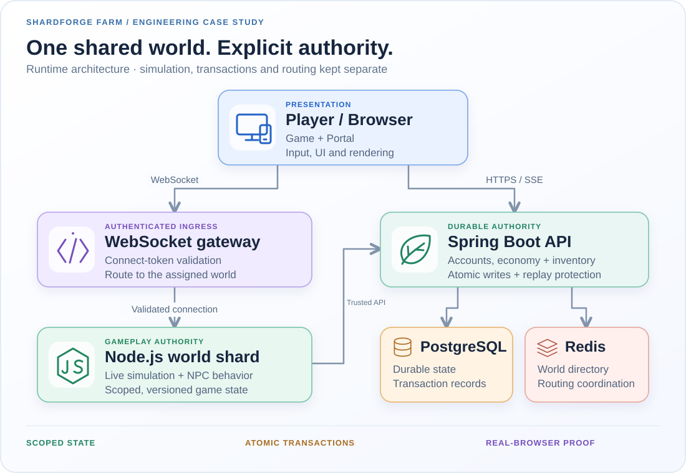

# R.A.M. FARM — engineering notes

A multiplayer farming game I'm building alongside my enterprise work. The source is private and the project is in development. This is a small architectural overview, not a claim about shipped scale or release readiness.

## The problem behind a simple action

A player clicks a ripe crop. Another player clicks it at almost the same time. One connection drops; the first client retries. The useful question is not whether the harvest animation looks right. It is whether the crop, inventory and ownership still agree afterwards.

That problem shapes the system more than the farming theme does.

## Three boundaries I keep explicit

**The browser presents the world.** It owns input, UI, camera and visual effects. A click expresses intent; it does not decide that a harvest succeeded or that an item belongs to the player.

**The Node.js runtime owns live gameplay.** It validates actions against the current world and map instance. Movement and map-local simulation stay here rather than becoming a round trip through the persistence API on every frame.

**Java/Spring and PostgreSQL own durable changes.** Inventory and ownership changes must survive retries and process restarts. Where an action couples world state with an inventory change, it needs an atomic transaction—not a debit followed by a best-effort grant.

These are domain boundaries, not an argument for splitting everything into microservices. The cost of operating a boundary has to earn its place.

## The failure cases matter

- **A repeated request:** return the recorded outcome rather than granting a second reward.
- **A late update:** reject stale state instead of overwriting a newer result.
- **A map transition:** retain explicit world/map/instance identity; do not guess a default scope.
- **A reconnect:** rebuild the view from authoritative state rather than treating a client cache as truth.

Different domains have their own lifecycle and version rules. A single generic "sync everything" abstraction would hide those differences rather than solve them.

## How I test it

Unit and contract tests cover the rules. Browser-driven gameplay tests cover the path from real player input through transport to server confirmation and back to the visible result.

A test that edits inventory directly cannot prove that harvesting works. A test that checks only the acting player's screen cannot prove that another player sees the same result. Those distinctions guide the test design.

## What this project lets me practise

Keeping Java persistence, a live simulation and a browser client consistent; deciding what belongs on each side; and making failures visible enough to diagnose. It is also an ongoing exercise in scope: reuse the systems that already exist before adding another framework.

[Back to profile](../README.md)
