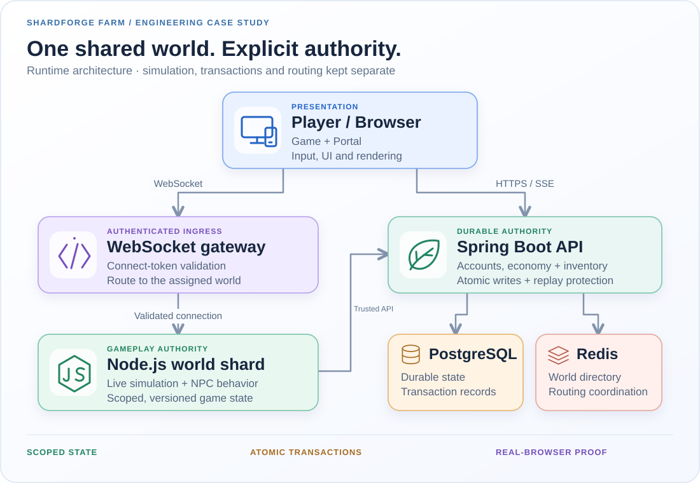

# SHARDFORGE FARM ⚙️🌾

**Cozy pixels. Hard-mode distributed systems.**

*Public engineering codename · Private monorepo · Active development*

Farming looks chill until two players harvest the same crop, one packet arrives late, and a reconnect replays an old command. **Only one harvest should win.** That's the real boss fight.

## System blueprint

<picture>
  <source media="(max-width: 600px)" srcset="../assets/system-mobile.svg" />
  
</picture>

| Boundary | What it owns |
| --- | --- |
| **Browser + Portal** | Input, pixel-art rendering, HUD, and previews. Never the source of economic truth. |
| **WebSocket gateway** | Authenticated connections routed to the right world runtime. |
| **Node.js world shard** | Real-time simulation, NPC behavior, movement, and scoped gameplay rules. |
| **Java / Spring Boot** | Durable accounts, land titles, inventory, economy, and transactional writes. |
| **PostgreSQL + Redis** | Persistent records and replay fences; world-to-runtime routing and coordination. |

A CDN can serve static assets, but it doesn't get a vote on gameplay state. This is a **logical architecture**, not a claim that a specific AWS deployment or scale is live.

## The engineering bits that hit different

- **No duplicate loot.** Crop-state and inventory changes share a durable transaction; retries replay the recorded outcome.
- **Every world has an address.** `worldId + mapId + mapInstanceId` scopes state. Map switches use explicit transitions, not best-guess fallbacks.
- **Stale packets don't time-travel.** Versioned snapshots, binary transport, and monotonic checks keep older state from winning.
- **Events, not spaghetti.** Typed EventBus boundaries and generated OpenAPI clients reduce cross-module guesswork.
- **An actual living world.** Deterministic weather, growing crops, animal companions, shared land, and physical travel run against server-owned rules.
- **Durability beyond the game loop.** Transactional outbox delivery and account-scoped live updates let Portal views recover after disconnects.

## One crop. Two players. One truth.

```text
Two harvest intents
       ↓
Validate player, range, map scope, and plot version
       ↓
Commit crop + inventory atomically (one winner)
       ↓
Return explicit results and newer world state
       ↓
Both players converge; retries cannot mint a second reward
```

**Player experience:** the winner gets the harvest; everyone else sees the same crop and a clear refusal rather than ghost items or a fake success animation.

## Proof > promises

PlayBot drives the **real browser → game protocol → Node authority** path. Critical shared-state checks need both a server-confirmed result and a client-observed outcome; observer clients must converge too. Unit, contract, and failure-path tests cover the lower layers.

**Status:** private, actively developed engineering/game project. No claims of public source, production traffic, launch date, or measured scalability. The source and unpublished game assets stay private.

[← Back to GitHub profile](../README.md)
