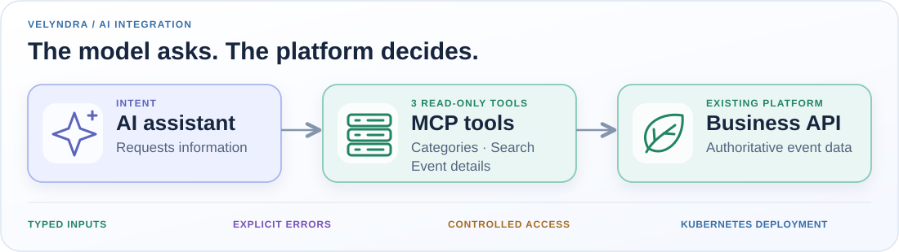

  <picture>
    <source media="(max-width: 680px)" srcset="../assets/velyndra-case-hero-mobile.svg" />
    
  </picture>

# Velyndra Event Systems — LLM/MCP Engineering Case Study

> **Anonymized real engagement (2026).** Velyndra Event Systems is a **fictional client alias**, not an actual employer. The work described is based on my engineering experience; identifying client details, internal code and original endpoints are intentionally omitted.

## The problem

An AI assistant needed to search an existing event catalog without inventing events or bypassing the platform's data rules. The model could understand the user's request, but **business data had to remain authoritative**.

## Architecture

  <picture>
    <source media="(max-width: 680px)" srcset="../assets/velyndra-architecture-mobile.svg" />
    
  </picture>

*Simplified logical view; not an actual deployment diagram.*

**Assistant → MCP server → API gateway → existing event services.**

I implemented the agent-facing integration and connected it to the existing API layer. Deployment used a Kubernetes-based cloud environment.

## Three focused tools

| Capability | What it provides |
| --- | --- |
| Categories | Browse event categories |
| Search | Find published events using structured filters |
| Details | Retrieve a specific event's information |

The tools were **read-only**, with typed arguments, validation, localized results and explicit errors. The assistant could request data, but it could not grant itself new business permissions.

## Engineering decisions

- **Source-backed answers:** event results originate from existing services, not model-generated records.
- **Predictable failures:** malformed inputs, missing results and upstream errors follow explicit paths.
- **Narrow scope:** event discovery only; no organizer or payment mutations.
- **Practical verification:** tool calls and failure paths were exercised through developer tooling and the integrated assistant workflow.

## Outcome

I delivered the integration from design through testing and deployment. The valuable engineering result was a **reliable connection between an LLM and an existing business platform**, not another standalone chatbot.

No private source, internal identifiers, customer data, performance numbers or unverifiable business claims are published here.

[← Back to profile](../README.md)
